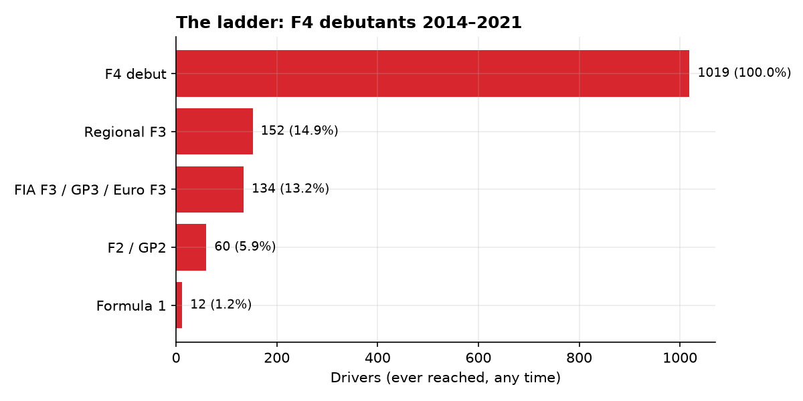
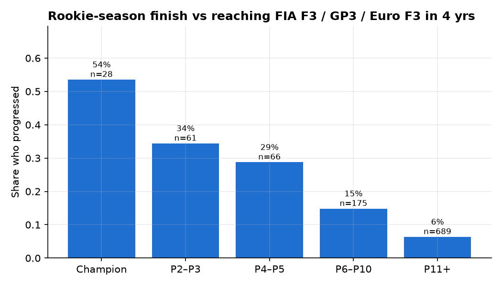

# From F4 to F1: predicting who climbs motorsport's junior ladder

Hundreds of drivers race Formula 4 every year. Only a handful ever reach Formula 1.
This project builds a dataset of every FIA Formula 4 championship since 2014 and every
higher championship on the ladder, then asks:

1. **How steep is the ladder?** What share of F4 debutants reach Formula Regional, FIA F3, F2 and F1?
2. **How much does a rookie season say?** Does finishing P1 vs P5 in your first F4 year change the odds?
3. **Are all F4 series equal?** Which championships have the strongest fields?
4. **Can we predict it?** Using only a driver's first F4 season, how well can a model rank who will reach FIA F3 level within 4 years?

Results are generated into [`reports/results.md`](reports/results.md) by the pipeline.

## Key findings

- **The ladder is steep:** of 1,019 F4 debutants (2014–2021), 13.2% reached FIA F3 level, 5.9% reached F2 and 12 drivers (1.2%) reached Formula 1.
- **The rookie season is a strong signal:** first-year F4 champions reached F3 level within 4 years 54% of the time, versus 6% for drivers finishing P11 or lower.
- **Where you race matters:** debutants in ADAC and Italian F4 progressed at 28%, versus about 2% in US, Japanese and Chinese F4.
- **Rookie-season data predicts progression:** on unseen 2019–2021 cohorts the model reached ROC-AUC 0.80–0.84 and PR-AUC 0.46–0.48 (base rate 11.8%, finish-only baseline 0.35). Half of the top 10% it flagged went on to reach F3 level, 4× the base rate.
- **Budget leaves a footprint:** after points share, the strongest predictor is how many F4 series a driver contested in their rookie year, a likely proxy for funding.




Full report: [reports/results.md](reports/results.md)

## Pipeline

```
Wikipedia season pages ──fetch──▶ data/raw/*.html  (cached, so later steps run offline)
        │
      build   parse each drivers' championship table: position, points, wins,
        │     podiums, poles (bold), fastest laps (italic), retirements
        ▼
data/processed/f4_results.csv     driver × F4 series × season
data/processed/ladder.csv         driver × higher series × season
        │
     features  one row per driver, from their ROOKIE F4 season only
        │      + series strength (two-way fixed-effects model)
        ▼
data/processed/drivers.csv
        │
      train   temporal split · 3 models · bootstrap CIs · calibration · importance
        ▼
reports/results.md · reports/figures/*.png · reports/watchlist.csv
```

| Stage | Module | What it does |
|---|---|---|
| Fetch | `wiki.py` | MediaWiki API with caching, retry and polite rate limiting |
| Parse | `parse.py` | Finds the drivers' standings table on a season page and extracts per-race results |
| Build | `build.py` | Tidy tables plus a page-level coverage audit |
| Strength | `strength.py` | Ranks F4 series by field quality using drivers who raced in several series in one year |
| Features | `features.py` | 13 rookie-season features and ladder outcomes, with leakage controls |
| Model | `model.py` | Baseline, logistic regression and gradient boosting; evaluation and figures |
| Report | `report.py` | Writes `reports/results.md` |

## Method choices worth discussing in an interview

**Prediction point.** Features use only the driver's first F4 season. That's the moment a team or
academy would decide whether to back a driver, and it rules out leaking later results into the model.

**Temporal validation.** Models train on 2014–2018 debutants and are tested on 2019–2021 debutants,
not on a random split. Random splits would let the model learn from drivers who raced alongside
test drivers and inflate scores.

**Right-censoring.** A 2024 debutant who hasn't reached F3 yet hasn't failed. Only cohorts whose full
4-year window is observed get a label. Open cases are scored separately in a watchlist.

**Imbalanced target.** Few drivers progress, so the headline metric is PR-AUC, alongside ROC-AUC,
Brier score and precision in the top 10%. Every test metric carries a bootstrap 95% confidence interval.

**Baseline first.** A one-feature model (rookie finishing position) sets the bar. Extra complexity
has to beat it out of sample to earn its place.

**Series strength without leakage.** A two-way fixed-effects model,
`finish percentile = driver-year ability + series difficulty`, is fitted only on training seasons.

**Entity resolution.** Drivers are linked across pages by their Wikipedia article, then by an
accent- and punctuation-insensitive name key.

## Quick start

```bash
git clone <your-repo> && cd f4-career-analytics
python -m venv .venv && source .venv/bin/activate      # Windows: .venv\Scripts\activate
make setup
make all        # fetch (~15 min first run, then cached) → build → train
make test       # 5 tests incl. an offline end-to-end run on synthetic data
```

Without `make`:
```bash
pip install -r requirements.txt
PYTHONPATH=src python -m f4ca all          # Windows PowerShell: $env:PYTHONPATH="src"
```

Options:
```bash
python -m f4ca train --target f2 --horizon 6      # predict reaching F2 within 6 years
python -m f4ca train --test-from 2018             # move the holdout boundary
python -m f4ca fetch --refresh                    # re-download all pages
```

Then open `notebooks/01_exploration.ipynb` for coverage maps, data-quality checks, transitions
between series and individual career look-ups.

## Data

- **Population:** 14 FIA-certified F4 championships, 2014–2025 (Italian, ADAC, British, Spanish, French,
  Japanese, US, Australian, Chinese, SEA, Danish, NEZ, Indian, UAE). Edit `config.py` to add more.
- **Outcomes:** Formula Regional European and Euroformula Open (regional), FIA F3 / GP3 / FIA European F3
  (tier 3), FIA F2 / GP2 (tier 2) and Formula 1.
- **Source:** English Wikipedia season articles, licensed CC BY-SA 4.0. Raw HTML is cached locally
  and not committed.

## Limitations

- Careers are shaped by budget, age, team, and manufacturer academies. None of these are in the data,
  so the model measures on-track signal only. Treat it as "how much does F4 performance explain?",
  not as a talent oracle.
- Wikipedia coverage varies by series and year; `coverage.csv` lists every missing or unparsed page.
- Some Wikipedia page titles change over time. If a season shows as missing, fix its title in `config.py`.

## Extending it

- Add driver age at debut (from each driver's article infobox). It is likely the strongest missing feature.
- Survival analysis (time-to-F3 with Kaplan–Meier / Cox) instead of a fixed horizon.
- Add team strength, or academy membership from the Red Bull, Ferrari, Alpine and Mercedes academy pages.
- Serve the watchlist as a Streamlit app.

## Project layout

```
├── src/f4ca/            pipeline package (python -m f4ca …)
├── tests/               parser tests + synthetic end-to-end test
├── notebooks/           exploration notebook
├── reports/             generated results.md, figures, metrics.json, watchlist.csv
├── data/                raw cache + processed CSVs (git-ignored)
├── Makefile · requirements.txt · pyproject.toml
```
