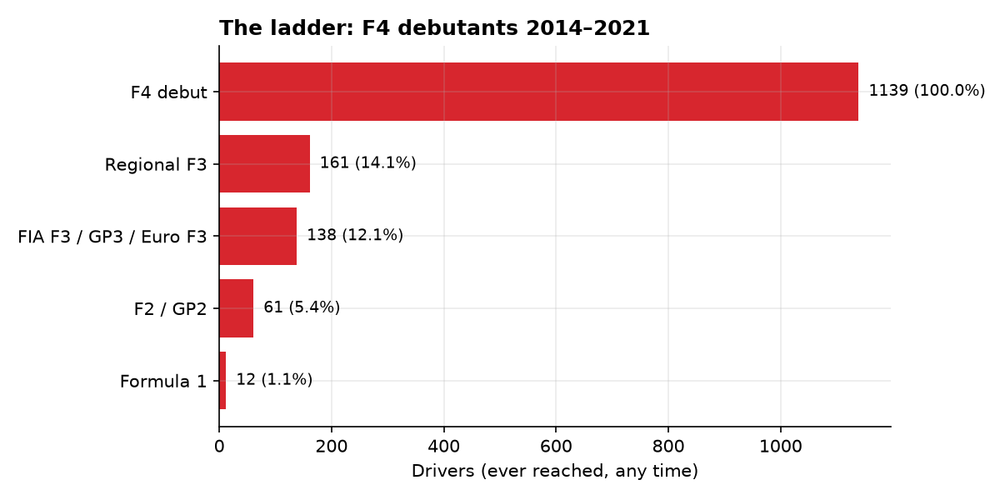
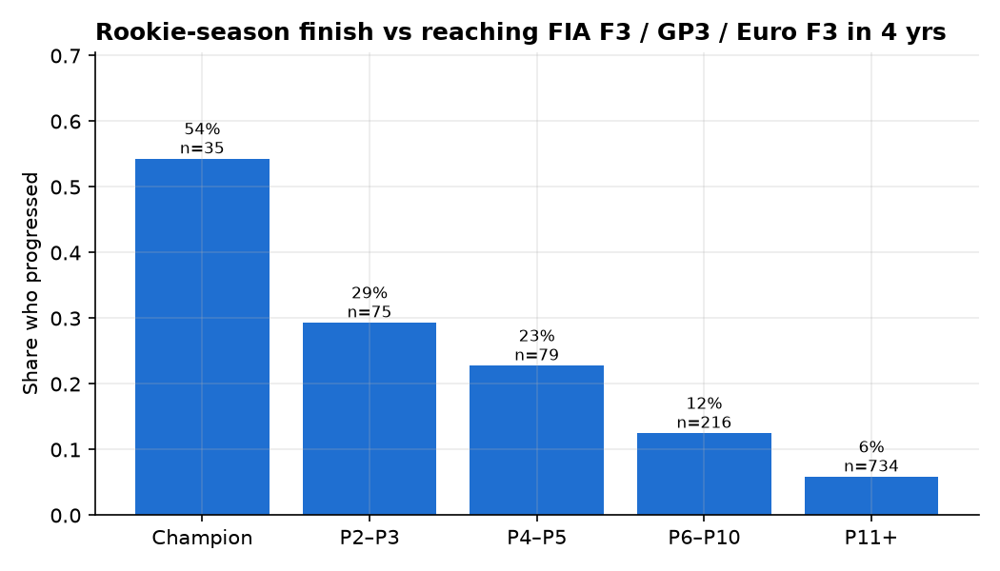
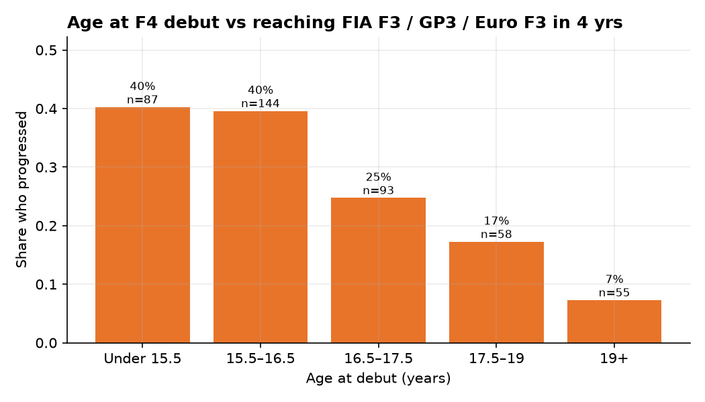

# Results: who climbs from Formula 4?

_Generated 06 Nov 2026 by `python -m f4ca all`. Numbers change if the data is re-scraped._

## Data
- **116** F4 championship seasons parsed across **14** series, plus **59** seasons of higher categories.
- **1,818** distinct F4 drivers; **1,139** have a fully observed 4-year outcome window (debut 2014–2021).
- Page-level audit: `data/processed/coverage.csv`.

## The ladder
| stage | drivers | share |
|---|---|---|
| F4 debut | 1139 | 100.0% |
| Regional F3 | 161 | 14.1% |
| FIA F3 / GP3 / Euro F3 | 138 | 12.1% |
| F2 / GP2 | 61 | 5.4% |
| Formula 1 | 12 | 1.1% |

## Rookie-season finish vs reaching FIA F3 / GP3 / Euro F3 within 4 years
| finish | drivers | progressed | rate |
|---|---|---|---|
| Champion | 35 | 19 | 54% |
| P2–P3 | 75 | 22 | 29% |
| P4–P5 | 79 | 18 | 23% |
| P6–P10 | 216 | 27 | 12% |
| P11+ | 734 | 43 | 6% |

## Progression rate by debut series (series with 10+ debutants)
| debut_series | drivers | progressed | rate |
|---|---|---|---|
| ADAC F4 | 85 | 24 | 28% |
| Italian F4 | 152 | 41 | 27% |
| British F4 | 79 | 15 | 19% |
| F4 UAE | 33 | 6 | 18% |
| French F4 | 93 | 16 | 17% |
| Spanish F4 | 63 | 10 | 16% |
| NEZ F4 | 53 | 4 | 8% |
| Danish F4 | 72 | 3 | 4% |
| US F4 | 171 | 4 | 2% |
| Japanese F4 | 180 | 4 | 2% |
| Australian F4 | 49 | 1 | 2% |
| Chinese F4 | 97 | 1 | 1% |
| SEA F4 | 12 | 0 | 0% |

## Model performance
Target: reached **FIA F3 / GP3 / Euro F3** within **4** years of F4 debut, predicted from the rookie season only.
Train cohorts 2014–2018, holdout cohorts 2019–2021.
Holdout: 447 drivers, 49 progressed (base rate 11.0%).

| Model | CV PR-AUC (train) | Test ROC-AUC (95% CI) | Test PR-AUC (95% CI) | Test Brier | Precision @ top 10% |
|---|---|---|---|---|---|
| Baseline: finish only | 0.323 | 0.808 (0.743–0.865) | 0.359 (0.251–0.504) | 0.084 | 40% |
| Logistic regression | 0.437 | 0.856 (0.797–0.908) | 0.468 (0.348–0.611) | 0.077 | 51% |
| Gradient boosting | 0.560 | 0.920 (0.890–0.950) | 0.562 (0.438–0.711) | 0.072 | 53% |

Selected model (best cross-validated PR-AUC on train): **Gradient boosting**.

## What drives the prediction
Permutation importance on the holdout set (Gradient boosting):

| feature | importance | std |
|---|---|---|
| age_at_debut | 0.277 | 0.044 |
| win_rate | 0.042 | 0.028 |
| series_strength | 0.042 | 0.020 |
| mean_pct | 0.041 | 0.026 |
| participation | 0.019 | 0.014 |
| n_series | 0.018 | 0.025 |
| pole_rate | 0.012 | 0.009 |
| fastest_lap_rate | 0.011 | 0.011 |

Logistic regression coefficients (per standard deviation; odds ratio > 1 raises the odds):

| feature | coef_per_sd | odds_ratio |
|---|---|---|
| age_at_debut | -0.58 | 0.56 |
| n_series | +0.58 | 1.78 |
| mean_pct | -0.53 | 0.59 |
| win_rate | +0.53 | 1.69 |
| fastest_lap_rate | -0.32 | 0.72 |
| series_strength | +0.30 | 1.36 |
| participation | +0.16 | 1.18 |
| podium_rate | +0.13 | 1.14 |

## Age at debut
Birth dates were found for **37%** of drivers (those with a Wikipedia article).
Coverage is uneven: 100% of drivers who progressed have a known age versus 30% of those who did not, because successful drivers are more likely to have an article. A "missing age" flag would therefore leak the outcome, so missing ages are imputed with the median and no missing-flag is given to the model.

Progression to FIA F3 / GP3 / Euro F3 within 4 years, by age at F4 debut (known ages only):

| age_group | drivers | progressed | rate |
|---|---|---|---|
| Under 15.5 | 87 | 35 | 40% |
| 15.5–16.5 | 144 | 57 | 40% |
| 16.5–17.5 | 93 | 23 | 25% |
| 17.5–19 | 58 | 10 | 17% |
| 19+ | 55 | 4 | 7% |

**Ablation** (logistic regression, holdout drivers with a known age: n=179, 49 progressed):

| Model | ROC-AUC | PR-AUC |
|---|---|---|
| Without age | 0.717 | 0.457 |
| With age | 0.747 | 0.474 |

## Watchlist: open cases, highest predicted probability
Drivers whose outcome window has not closed yet and who have not reached FIA F3 / GP3 / Euro F3.

| driver | debut_season | debut_series | best_pos | n_series | probability |
|---|---|---|---|---|---|
| Rashid Al Dhaheri | 2023 | Italian F4 | 10 | 2 | 87% |
| Maciej Gładysz | 2024 | Spanish F4 | 3 | 1 | 86% |
| Salim Hanna | 2025 | Italian F4 | 4 | 3 | 84% |
| Tiago Rodrigues | 2023 | Chinese F4 | 1 | 2 | 83% |
| Andrés Cárdenas | 2023 | Spanish F4 | 8 | 1 | 77% |
| Niccolò Maccagnani | 2025 | SEA F4 | 4 | 2 | 76% |
| Sebastian Wheldon | 2025 | Italian F4 | 3 | 2 | 75% |
| Jules Caranta | 2024 | French F4 | 3 | 2 | 67% |
| Ariel Elkin | 2023 | Italian F4 | 14 | 2 | 65% |
| Keanu Al Azhari | 2023 | F4 UAE | 7 | 2 | 65% |
| Zachary David | 2022 | Italian F4 | 15 | 2 | 63% |
| Cooper Shipman | 2025 | US F4 | 1 | 1 | 62% |
| Valentin Kluss | 2022 | Italian F4 | 11 | 2 | 62% |
| Kanato Le | 2023 | F4 UAE | 7 | 2 | 60% |
| Edu Robinson | 2024 | Italian F4 | 19 | 1 | 60% |

## Caveats
- Wikipedia coverage is uneven; missing seasons are listed in `coverage.csv`.
- Money, age, team and junior-academy membership drive careers but are not in the data. The model measures on-track signal only.
- Drivers are matched across pages by Wikipedia article, then by normalised name; rare mismatches are possible.
- Series strength is estimated from drivers who raced in several F4 championships in the same year, using training seasons only.
