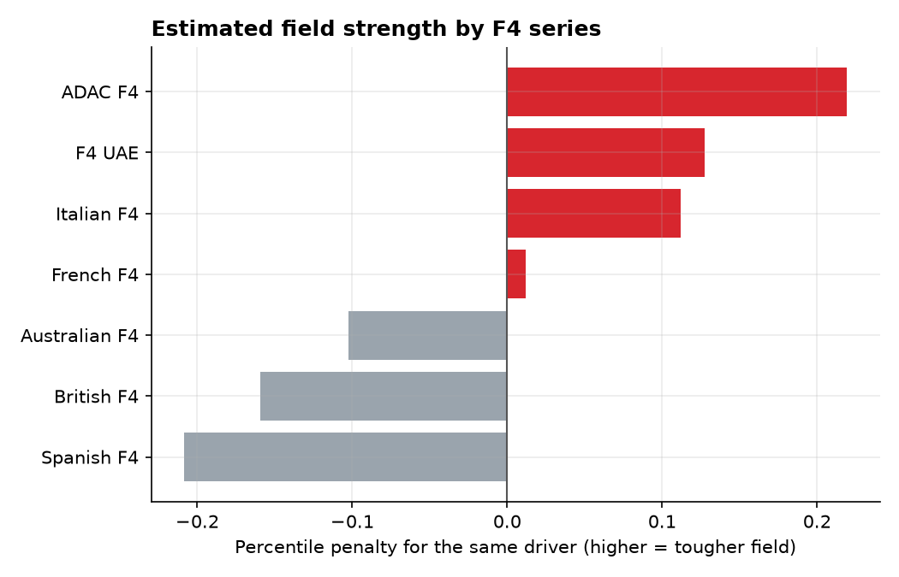
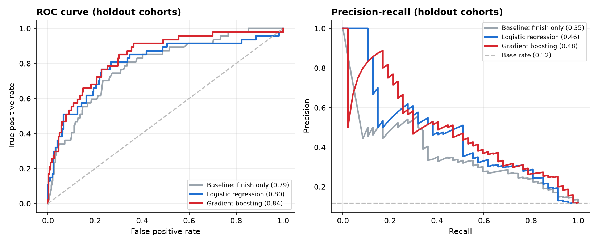
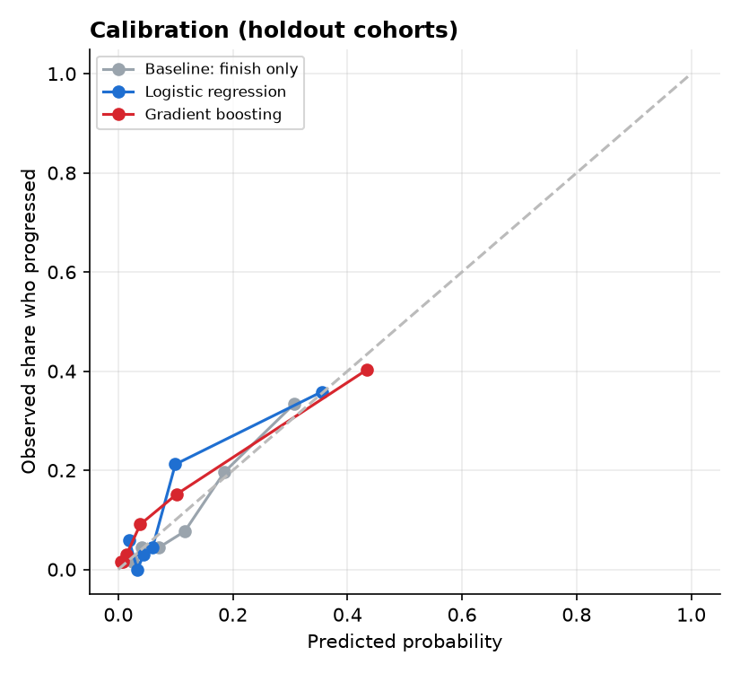
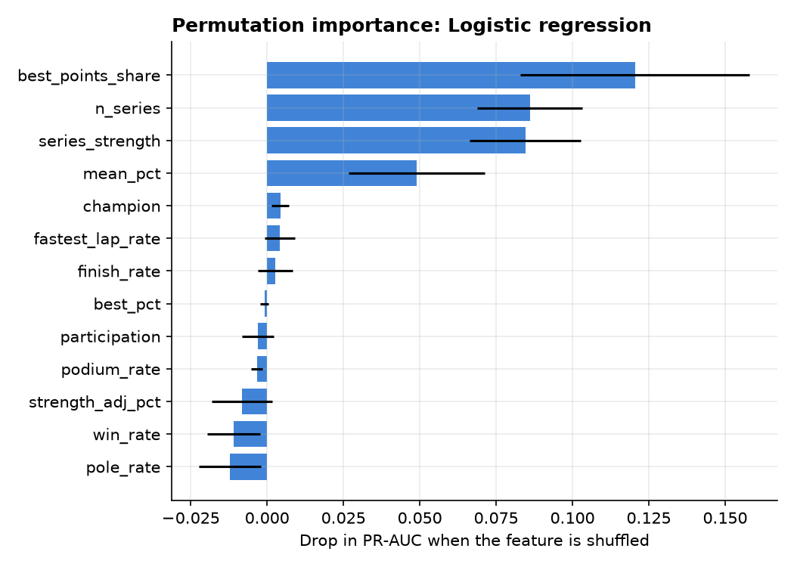

# Results: who climbs from Formula 4?

_Generated 06 Nov 2026 by `python -m f4ca all`. Numbers change if the data is re-scraped._

## Data
- **95** F4 championship seasons parsed across **11** series, plus **59** seasons of higher categories.
- **1,650** distinct F4 drivers; **1,019** have a fully observed 4-year outcome window (debut 2014–2021).
- Page-level audit: `data/processed/coverage.csv`.

## The ladder
| stage | drivers | share |
|---|---|---|
| F4 debut | 1019 | 100.0% |
| Regional F3 | 152 | 14.9% |
| FIA F3 / GP3 / Euro F3 | 134 | 13.2% |
| F2 / GP2 | 60 | 5.9% |
| Formula 1 | 12 | 1.2% |

## Rookie-season finish vs reaching FIA F3 / GP3 / Euro F3 within 4 years
| finish | drivers | progressed | rate |
|---|---|---|---|
| Champion | 28 | 15 | 54% |
| P2–P3 | 61 | 21 | 34% |
| P4–P5 | 66 | 19 | 29% |
| P6–P10 | 175 | 26 | 15% |
| P11+ | 689 | 44 | 6% |

## Progression rate by debut series (series with 10+ debutants)
| debut_series | drivers | progressed | rate |
|---|---|---|---|
| ADAC F4 | 89 | 25 | 28% |
| Italian F4 | 159 | 44 | 28% |
| British F4 | 80 | 16 | 20% |
| French F4 | 97 | 17 | 18% |
| F4 UAE | 13 | 2 | 15% |
| Spanish F4 | 81 | 11 | 14% |
| US F4 | 173 | 4 | 2% |
| Japanese F4 | 181 | 4 | 2% |
| Australian F4 | 49 | 1 | 2% |
| Chinese F4 | 97 | 1 | 1% |

## Model performance
Target: reached **FIA F3 / GP3 / Euro F3** within **4** years of F4 debut, predicted from the rookie season only.
Train cohorts 2014–2018, holdout cohorts 2019–2021.
Holdout: 398 drivers, 47 progressed (base rate 11.8%).

| Model | CV PR-AUC (train) | Test ROC-AUC (95% CI) | Test PR-AUC (95% CI) | Test Brier | Precision @ top 10% |
|---|---|---|---|---|---|
| Baseline: finish only | 0.325 | 0.789 (0.724–0.851) | 0.348 (0.237–0.493) | 0.091 | 40% |
| Logistic regression | 0.462 | 0.804 (0.723–0.876) | 0.463 (0.321–0.604) | 0.083 | 48% |
| Gradient boosting | 0.409 | 0.840 (0.774–0.897) | 0.484 (0.353–0.636) | 0.083 | 50% |

Selected model (best cross-validated PR-AUC on train): **Logistic regression**.

## What drives the prediction
Permutation importance on the holdout set (Logistic regression):

| feature | importance | std |
|---|---|---|
| best_points_share | 0.120 | 0.038 |
| n_series | 0.086 | 0.017 |
| series_strength | 0.085 | 0.018 |
| mean_pct | 0.049 | 0.022 |
| champion | 0.004 | 0.003 |
| fastest_lap_rate | 0.004 | 0.005 |
| finish_rate | 0.003 | 0.006 |
| best_pct | -0.001 | 0.001 |

Logistic regression coefficients (per standard deviation; odds ratio > 1 raises the odds):

| feature | coef_per_sd | odds_ratio |
|---|---|---|
| series_strength | +0.67 | 1.95 |
| best_points_share | +0.53 | 1.70 |
| mean_pct | -0.40 | 0.67 |
| n_series | +0.36 | 1.44 |
| win_rate | +0.19 | 1.21 |
| strength_adj_pct | +0.18 | 1.20 |
| pole_rate | +0.15 | 1.16 |
| finish_rate | +0.13 | 1.14 |

## Watchlist: open cases, highest predicted probability
Drivers whose outcome window has not closed yet and who have not reached FIA F3 / GP3 / Euro F3.

| driver | debut_season | debut_series | best_pos | n_series | probability |
|---|---|---|---|---|---|
| William Macintyre | 2023 | F4 UAE | 2 | 2 | 86% |
| Kean Nakamura-Berta | 2024 | F4 UAE | 2 | 2 | 84% |
| Matteo De Palo | 2023 | Italian F4 | 5 | 3 | 80% |
| Jules Caranta | 2024 | French F4 | 3 | 2 | 76% |
| Nicolas Stati | 2024 | US F4 | 2 | 2 | 76% |
| James Piszcyk | 2023 | F4 UAE | 5 | 2 | 69% |
| Yuhao Fu | 2024 | Chinese F4 | 4 | 3 | 65% |
| Dion Gowda | 2023 | British F4 | 4 | 3 | 64% |
| Hiyu Yamakoshi | 2023 | French F4 | 5 | 3 | 64% |
| Kanato Le | 2023 | F4 UAE | 7 | 2 | 62% |
| Nandhavud Bhirombhakdi | 2022 | ADAC F4 | 14 | 3 | 60% |
| Cooper Webster | 2023 | Indian F4 | 1 | 1 | 58% |
| Sebastian Wheldon | 2025 | Italian F4 | 3 | 1 | 58% |
| Chester Kieffer | 2024 | French F4 | 4 | 3 | 58% |
| Zhang Shimo | 2025 | Chinese F4 | 1 | 1 | 57% |

## Caveats
- Wikipedia coverage is uneven; missing seasons are listed in `coverage.csv`.
- Money, age, team and junior-academy membership drive careers but are not in the data. The model measures on-track signal only.
- Drivers are matched across pages by Wikipedia article, then by normalised name; rare mismatches are possible.
- Series strength is estimated from drivers who raced in several F4 championships in the same year, using training seasons only.
